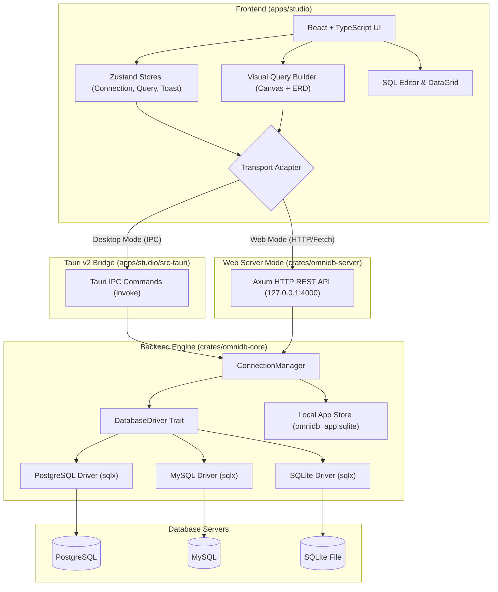

# OmniDB

> A high-performance, lightweight, cross-platform database management studio and visual query designer built with **Rust**, **Tauri v2**, **React**, and **TypeScript**.

OmniDB offers a blazing-fast, modern alternative to legacy database clients (such as DBeaver or pgAdmin). It combines multi-engine SQL execution and schema management with an interactive, drag-and-drop visual ERD and query builder.

---

## Key Features

- **Multi-Database Support**:
  - Connect to **PostgreSQL**, **MySQL**, and **SQLite** through a unified database abstraction layer powered by `sqlx`.
  - Local encrypted storage in SQLite (`omnidb_app.sqlite`) for managing saved connection credentials.
  - Automatic SSL / TLS configuration and connection pooling.

- **Interactive Visual Query & ERD Builder**:
  - Freeform canvas workspace with pan and multi-table organization.
  - **Drag-and-Drop** tables directly from the Database Explorer onto the canvas.
  - **Automatic Foreign Key Detection**: Connects related tables using Bezier curves and suggests JOIN criteria (`INNER`, `LEFT`, `RIGHT`, `FULL`).
  - **Topological Layout Engine**: Automatic reordering and alignment of tables based on relational dependencies.
  - Real-time SQL code generation and synchronization with the query workspace.

- **Advanced SQL Editor**:
  - Multi-tab query workspace with unsaved change tracking and tab history.
  - Synchronized line numbering gutter with multi-statement boundary detection.
  - Run individual statements, selected statements, or execute multiple queries in parallel.
  - Query Copilot assistant for query formulation, optimization, and explain analysis.

- **Schema & Data Manipulation**:
  - Full schema hierarchy browsing (databases, schemas, tables, views).
  - Cross-schema table relocation with instant SQL preview and confirmation dialogs.
  - In-place grid cell editing with single-click change detection and updates.
  - Table Designer for modifying columns, datatypes, default values, and primary keys.
  - Selective table backup and export utilities.

- **Deployment Flexibility**:
  - **Desktop Application**: Packaged via **Tauri v2** into native macOS (`.app` / `.dmg`), Linux, and Windows desktop apps.
  - **Web Studio & Backend**: Standalone Axum HTTP/REST API server (`omnidb-server`) paired with the React frontend for client-server deployment.

---

## Architecture Overview

OmniDB is organized as a Cargo workspace with modular Rust backend crates and a modern React frontend.

```
OmniDB/
├── Cargo.toml                  # Workspace manifest
├── apps/
│   └── studio/                 # Frontend React Application & Tauri App
│       ├── src/                # React 18, TypeScript, Tailwind CSS
│       │   ├── adapters/       # Pluggable Transport Layer (Desktop IPC vs HTTP)
│       │   ├── components/     # UI Components (Canvas, Editor, Grid, Schema)
│       │   ├── stores/         # State Management via Zustand
│       │   └── types/          # TypeScript Domain Interfaces
│       └── src-tauri/          # Tauri v2 Rust desktop bridge & IPC commands
└── crates/
    ├── omnidb-core/            # Core DB driver abstractions, crypto & managers
    ├── omnidb-server/          # Standalone Axum HTTP API & WebSocket server
    ├── omnidb-desktop/         # Desktop application support logic
    └── omnidb-wasm/            # WebAssembly bindings (in-browser SQLite/parsers)
```

### Architecture Diagram



### Transport Abstraction Layer

The UI communicates through an agnostic `OmniDBTransport` interface:
- **`desktop.ts`**: Uses Tauri's `@tauri-apps/api/core` `invoke()` calls to communicate directly with native Rust threads without HTTP overhead.
- **`web.ts`**: Uses standard `fetch()` API calls against `omnidb-server` when running in a pure browser environment.

---

## Crates & Packages

| Package | Language | Role |
| :--- | :--- | :--- |
| **`omnidb-core`** | Rust | Defines `DatabaseDriver`, handles driver initialization, capabilities detection, connection pooling, and credential storage in SQLite. |
| **`omnidb-server`** | Rust | Axum web server exposing the `omnidb-core` engine over REST APIs for browser clients. |
| **`apps/studio/src-tauri`** | Rust | Tauri v2 desktop application entrypoint, menu bar setup, window vibrancy, and IPC handlers. |
| **`apps/studio`** | TS/React | Frontend UI featuring Monaco-style syntax workflows, dynamic data grids, and the visual query builder canvas. |
| **`omnidb-wasm`** | Rust / WASM | WebAssembly bindings for lightweight client-side parsing and in-browser SQL evaluation. |

---

## Getting Started

### Prerequisites

- **Rust** (1.78+ recommended): [rustup.rs](https://rustup.rs/)
- **Node.js** (v18+ or v20+): [nodejs.org](https://nodejs.org/)
- **OS Dependencies** (for Tauri on Linux / macOS):
  - macOS: Xcode Command Line Tools (`xcode-select --install`)
  - Linux: `libwebkit2gtk-4.1-dev`, `build-essential`, `curl`, `wget`, `file`, `libssl-dev`, `libgtk-3-dev`

---

### Running the Desktop Application (Tauri Dev Mode)

Run the desktop application with live hot-reloading:

```bash
# 1. Install frontend dependencies
cd apps/studio
npm install

# 2. Run Tauri development mode
npm run tauri dev
```

---

### Running the Web Server & Studio Separately

To run OmniDB as a local web service:

```bash
# Terminal 1: Start the backend server
cargo run -p omnidb-server

# Terminal 2: Start the frontend development server
cd apps/studio
npm install
npm run dev
```

Visit `http://localhost:3000` in your browser.

---

### Building Release Binaries & Installers

To package the standalone desktop installer for your operating system:

```bash
cd apps/studio
npx tauri build
```

The resulting release packages will be created under:
- **macOS**: `target/release/bundle/macos/` (`.app`) and `target/release/bundle/dmg/` (`.dmg`)
- **Linux**: `target/release/bundle/deb/` or `target/release/bundle/appimage/`
- **Windows**: `target/release/bundle/msi/` or `target/release/bundle/nsis/`

---

## License

This project is licensed under the MIT License or Apache-2.0 License.
